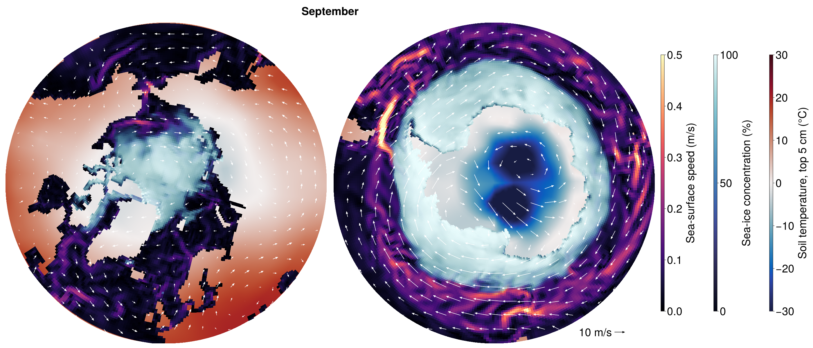

# Coarse CMIP

This example runs one year of the coarse fully coupled configuration,
`config/longrun_configs/cmip_coarse.yml`, on one GPU, and plots the monthly-mean wind over the polar
oceans, their sea ice, and the surrounding land.

## Setup

| Component  | Model                          | Grid                                                                   | Time step |
|:-----------|:-------------------------------|:-----------------------------------------------------------------------|:----------|
| Atmosphere | ClimaAtmos                     | cubed sphere, 6 × 6 elements per panel (about 5°), 10 levels to 30 km  | 600 s     |
| Land       | ClimaLand (soil, canopy, snow) | the atmosphere's surface                                               | 600 s     |
| Ocean      | Oceananigans                   | eORCA1 tripolar grid (1°), 10 levels to 5500 m                         | 3600 s    |
| Sea ice    | ClimaSeaIce                    | the ocean grid                                                         | 3600 s    |

The atmosphere has the eddy-diffusivity turbulence and 0-moment microphysics of
`config/atmos_configs/climaatmos_edonly.yml`, all-sky radiation every hour, fixed trace gases, and no
aerosols or gravity-wave drag. `toml/cmip_coarse.toml` weakens the subgrid variance of its cloud scheme
for the coarse grid and sets 150 cloud droplets per cm³, and the shortwave sees the clouds without the
scaling for unresolved inhomogeneity. The land reads the MODIS monthly
leaf-area-index climatology. With 10 levels, the ocean uses `simplified_ocean_closure`: convective
adjustment, a background vertical diffusivity, and biharmonic horizontal viscosity. Fluxes are exchanged
every 600 s, those between the atmosphere and the ocean or sea ice on the exchange grid (see
[Exchange (intersection) grid](@ref)). The run starts on 1 January 2010 from a dry atmosphere at rest
whose temperature decays from 290 K at the surface to 220 K aloft (`DecayingProfile`), and from EN4
(ocean) and ECCO4 (sea ice), in `Float32`.

## Running

Start Julia in a new environment, on a machine with an NVIDIA GPU:

```bash
CLIMACOMMS_DEVICE=CUDA julia --project=coarse_cmip
```

Install the packages once:

```julia
using Pkg
Pkg.add(name = "ClimaCore", version = "1.0.5")
Pkg.add(["ClimaCoupler", "ClimaAtmos", "ClimaLand", "Oceananigans", "ClimaSeaIce", "ConservativeRegridding"])
Pkg.add(["ClimaComms", "CUDA"]) # For using an NVIDIA GPU
Pkg.add(["ClimaAnalysis", "CairoMakie"]) # For plotting
```

Then load them, shorten the run from 30 years to one, and run it:

```julia
using ClimaCoupler
# The component models and the packages that load ClimaCoupler's extensions for them
import ClimaAtmos, ClimaLand, Oceananigans, ClimaSeaIce, ConservativeRegridding
import ClimaComms
ClimaComms.@import_required_backends

config_file = joinpath(pkgdir(ClimaCoupler), "config", "longrun_configs", "cmip_coarse.yml")
config_dict = Input.get_coupler_config_dict(config_file)
config_dict["t_end"] = "365days"
cs = CoupledSimulation(config_dict)
run!(cs)
```

The first run will take some time to setup and compile, but once it is running it should finish in ~1 hour depending on your card.
Every component writes monthly means to `output/cmip_coarse`, about 1 GB in all.

## Plotting

The figure shows September, near the smallest extent of Arctic sea ice and the largest of Antarctic sea
ice: monthly means of the wind at the lowest model level (about 250 m) as white arrows, over the sea-ice
concentration, the ocean surface speed and the soil temperature of the top 5 cm, poleward of 45°N
(left) and 45°S (right). Each map is the orthographic projection onto the plane tangent
at its pole.

```julia
using CairoMakie, Dates, Oceananigans
import ClimaAnalysis
using LinearAlgebra: normalize

month = 9
month_start = DateTime(2010, month)

# Atmosphere and land monthly means are stamped at the start of their month, ocean and sea-ice ones at the end
atmos = ClimaAnalysis.SimDir(cs.dir_paths.atmos_output_dir)
uas, vas = map(("uas", "vas")) do short_name
    var = get(atmos; short_name, reduction = "average", period = "1M")
    return ClimaAnalysis.slice(var; time = month_start)
end
land = ClimaAnalysis.SimDir(cs.dir_paths.land_output_dir)
tsoil = get(land; short_name = "tsoil", reduction = "average", period = "1M")
tsoil = ClimaAnalysis.slice(tsoil; time = month_start, z = 0)  # the top layer

ocean_file = joinpath(cs.dir_paths.ocean_output_dir, "ocean_surface.jld2")
ice_file = joinpath(cs.dir_paths.ice_output_dir, "seaice_surface.jld2")
U, V = (FieldTimeSeries(ocean_file, name; backend = OnDisk())
        for name in ("sea_surface_zonal_velocity", "sea_surface_meridional_velocity"))
ℵ = FieldTimeSeries(ice_file, "ice_concentration"; backend = OnDisk())
n = findfirst(==(month_start + Month(1)), U.times)
grid = U.grid
Nx, Ny = grid.Nx, grid.Ny
speed = hypot.(interior(U[n], :, :, 1), interior(V[n], :, 1:Ny, 1))
concentration = interior(ℵ[n], :, :, 1)

# Position on the map [Earth radii] of longitude λ and latitude φ around the pole of hemisphere h (1 north,
# -1 south), and the directions of east and north there. The maps reach 45° latitude.
project(λ, φ, h) = Point2f(cosd(φ) * sind(λ), -h * cosd(φ) * cosd(λ))
east(λ, h) = Vec2f(cosd(λ), h * sind(λ))
north(λ, φ, h) = sind(φ) * Vec2f(-sind(λ), h * cosd(λ))
radius = cosd(45)

# Ocean cells colored by sea-ice concentration over surface speed, drawn as quadrilaterals between their
# corners over the soil temperature
speed_colors, ice_colors, speed_range = cgrad(:magma), cgrad(:ice), (0, 0.5)
soil_colors, soil_range = cgrad(:balance), (-30, 30)
colors = map(speed, concentration) do s, c
    ocean = speed_colors[min(s / speed_range[2], 1)]
    return RGBAf(Makie.weighted_color_mean(c, ice_colors[c], ocean))
end
wet = grid.immersed_boundary.bottom_height[1:Nx, 1:Ny, 1] .< 0
latitudes = φnodes(grid, Center(), Center(), Center())
corner_longitudes = λnodes(grid, Face(), Face(), Center())
corner_latitudes = φnodes(grid, Face(), Face(), Center())
corners(i, j) = ((i, j), (i % Nx + 1, j), (i % Nx + 1, j + 1), (i, j + 1))

# Arrows on a square grid of each map, outside the latitude rows at the poles, where the wind has no
# direction. An arrow is `scale` Earth radii long per m s⁻¹.
spacing, scale = 0.062, 4.5e-3
inner_radius = cosd(ClimaAnalysis.latitudes(uas)[2])
offsets = -radius:spacing:radius
tails = [Point2f(x, y) for x in offsets, y in offsets if inner_radius < hypot(x, y) < radius]
style = (shaftwidth = 1.5, tipwidth = 7, tiplength = 8)

fig = Figure(size = (2800, 1200), fontsize = 38)
Label(fig[0, 1:2], monthname(month); font = :bold)
maps = map(((1, 1), (2, -1))) do (column, h)
    ax = Axis(fig[1, column]; aspect = DataAspect(), limits = (-radius, radius, -radius, radius))
    hidedecorations!(ax)
    hidespines!(ax)
    soil = ClimaAnalysis.resampled_as(tsoil; lon = collect(-180.0:180), lat = sort(h .* collect(45.0:90)))
    soil_points = project.(ClimaAnalysis.longitudes(soil), ClimaAnalysis.latitudes(soil)', h)
    surface!(ax, first.(soil_points), last.(soil_points), zeros(size(soil_points));
             color = soil.data .- 273.15, colormap = soil_colors, colorrange = soil_range, shading = NoShading)
    cells = filter(I -> wet[I] && h * latitudes[I] >= 45, CartesianIndices(wet))
    vertices = [project(corner_longitudes[c...], corner_latitudes[c...], h)
                for I in cells for c in corners(Tuple(I)...)]
    quads = permutedims(reshape(1:length(vertices), 4, :))
    mesh!(ax, vertices, [quads[:, [1, 2, 3]]; quads[:, [1, 3, 4]]];
          color = repeat(colors[cells]; inner = 4), shading = NoShading)
    directions = map(tails) do p
        λ, φ = atand(p[1], -h * p[2]), h * acosd(hypot(p...))
        eastward, northward = uas([λ, φ]), vas([λ, φ])
        wind = eastward * east(λ, h) + northward * north(λ, φ, h)
        return scale * hypot(eastward, northward) * normalize(wind)
    end
    arrows2d!(ax, tails, directions; color = :white, style...)
    return ax
end
reference = radius * Point2f(0.75, -0.93)
arrows2d!(maps[2], [reference], [Vec2f(10scale, 0)]; color = :black, style...)
text!(maps[2], reference - Vec2f(0.012, 0); text = "10 m/s", align = (:right, :center))
colorbars = GridLayout(fig[1, 3]; default_colgap = 60)
Colorbar(colorbars[1, 1]; colormap = speed_colors, limits = speed_range,
         label = "Sea-surface speed (m/s)", height = Relative(0.8))
Colorbar(colorbars[1, 2]; colormap = ice_colors, limits = (0, 100),
         label = "Sea-ice concentration (%)", height = Relative(0.8))
Colorbar(colorbars[1, 3]; colormap = soil_colors, limits = soil_range,
         label = "Soil temperature, top 5 cm (°C)", height = Relative(0.8))
save("polar_winds.png", fig; px_per_unit = 1)
```


